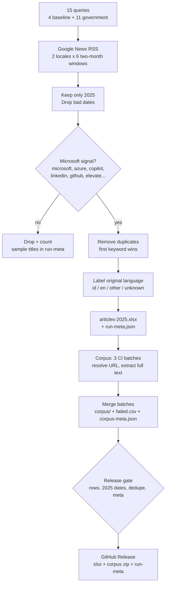

# Microsoft Indonesia 2025 — News Article Scraper

**In plain language:** this project collects news articles about Microsoft in Indonesia published in 2025 and puts them into one Excel file — deduplicated and filtered so only Microsoft-related stories remain. It runs whenever you press the button, and every run publishes downloadable files. No coding is needed to get the data.

## Download the Excel (no coding)

1. Open the [Releases page](../../releases).
2. Click the newest release named `articles-2025-*`.
3. Download `articles-2025.xlsx`.
4. Open it in Excel or Google Sheets.
5. Done — see "What's inside the Excel" below to read it.

## When does scraping run?

- **Manually, whenever needed** — repo page → `Actions` → `scrape` → `Run workflow` → `Run workflow`. Each run publishes a new dated Release.
- **Never automatically** — no schedule, and pushing commits or opening pull requests does *not* trigger a scrape. This is deliberate: every run hits Google News and mints a Release, so runs happen on demand, not per commit.

## How it works

In words, one run does this:

1. **Search** — asks Google News for 4 baseline queries and 11 government-targeted queries, in Indonesian and English locales, split into six two-month windows per query so each RSS response stays under the 100-item cap. If a window hits the cap anyway, `run-meta.json` records a warning.
2. **Filter by date** — keeps only articles from 1 Jan to 31 Dec 2025. Anything else (including 2026) is dropped and counted.
3. **Microsoft relevance gate** — keeps a row only when its title or snippet mentions a Microsoft signal (`microsoft`, `azure`, `microsoft 365`, `office 365`, `copilot`, `linkedin`, `github`, `elevaiate`, `elevate`). Dropped titles are sampled in `run-meta.json`.
4. **Remove duplicates** — the same article often matches several queries; it is kept once. The first keyword goes in `Keyword_Found`, the rest in `Also_Found_In`, and every query group that found it goes in `Found_In_Groups`.
5. **Label language, never translate** — the original Indonesian or English title and snippet are stored as published. `Source_Lang` is `id`, `en`, `other`, or `unknown`; an unknown result is never forced to `id`.
6. **Classify** — `.go.id` publishers get `Source_Type=government`; a ministry/agency alias found in the title, snippet, or publisher is stored in `Government_Body`.
7. **Write the Excel + run log** — one styled `.xlsx` plus `run-meta.json` with per-query/per-window raw, kept, and dropped counts, plus any query errors.
8. **Build the corpus** — three parallel CI batches fetch each publisher article (never the Google News interstitial), extract full text, and write one `.docx` per readable row. A merge job combines the batches and updates `Fulltext_Status`/`Docx_File` in the xlsx.
9. **Gate + publish** — the release gate refuses to publish zero rows, non-2025 dates, duplicate URLs, missing metadata, or a missing batch. The Release contains the xlsx, the corpus zip, and `run-meta.json`.

## Methodology (for papers and theses)

Copy the citable 1-page version from [`docs/methodology-note.md`](docs/methodology-note.md). Summary:

- **Source:** Google News RSS search (`news.google.com/rss/search`), no API keys. Two locales: Indonesian (`hl=id, gl=ID`) and English (`hl=en-US, gl=US`).
- **Queries (15):** four baseline queries (`kerja sama microsoft dengan pemerintah indonesia di tahun 2025` · `investasi microsoft di Indonesia tahun 2025` · `Indonesia central cloud region microsoft (2025)` · `Microsoft elevAIte di Indonesia 2025`) and eleven government-targeted queries (`microsoft kementerian`, `microsoft komdigi`, `microsoft kementerian komunikasi dan digital`, `microsoft kemenag`, `microsoft kementerian investasi`, `microsoft kemenko perekonomian`, `microsoft kementerian keuangan`, `microsoft kementerian pendidikan`, `microsoft pemerintah daerah`, `microsoft pemprov`, `microsoft dinas pendidikan`).
- **Query windows:** each query runs with `after:`/`before:` for six 2025 two-month windows, in both locales.
- **Date filter (strict 2025):** only `2025-01-01`–`2025-12-31` kept; unparseable/out-of-range dates dropped and counted.
- **Relevance gate:** only rows whose cleaned title+snippet contain a Microsoft signal are kept; drops are counted and sampled in `run-meta.json`.
- **Dedupe rule:** Google News links are keyed without query parameters; other URLs have tracking parameters removed and remaining parameters sorted. First-seen kept; repeats recorded in `Also_Found_In` and `Found_In_Groups`.
- **Language rule:** language is detected on HTML-cleaned text and labeled `id`/`en`/`other`/`unknown`. Original text is stored exactly as published; there is no machine translation.
- **Reproducibility:** every run writes `run-meta.json` (`run_utc`, queries, windows, counts, errors). Cite the git commit SHA + `run_utc` from that file.

## What's inside the Excel

One main sheet, with AutoFilter enabled so any column (including `Fulltext_Status`) can be filtered.

| Column | Meaning |
|---|---|
| No | Row number |
| Publisher | News outlet (e.g. Kompas.com, CNBC Indonesia) |
| Publisher_Domain | Host from the RSS `<source url=...>` link |
| Source_Type | `government` when the publisher host ends with `.go.id`, else `other` |
| Query_Group | Group that first found it: `baseline` or `government` |
| Found_In_Groups | All query groups that found it |
| Title | Original title as published (no translation) |
| Snippet | Original short description, HTML-cleaned |
| URL | Link to the article (Google News RSS link) |
| Date | Publication date (`YYYY-MM-DD`, always 2025) |
| Keyword_Found | First query that found it |
| Also_Found_In | Other queries that also matched it |
| Source_Lang | Detected language: `id` / `en` / `other` / `unknown` |
| Government_Body | First matched ministry/agency alias, else empty |
| Fulltext_Status | `pending`, then `ok` / `paywall` / `blocked` / `removed` / `thin` / `fetch_error` / `decode_failed` / `internal_error` |
| Docx_File | Corpus filename, filled only when `Fulltext_Status=ok` |

## Corpus (docx, for NVivo)

- **What it is:** one `.docx` per readable article containing the original full text (English stays English, Indonesian stays Indonesian), a Heading-1 title, and metadata lines (publisher, date, keyword, accessed UTC date, language, original URL, resolved publisher URL when available).
- **Build locally:** `make corpus` reads `output/articles-2025.xlsx` and writes `corpus/` + `failed.csv` + `corpus-meta.json`. Fast check: `make corpus-test` (first 5 rows, writes `corpus-preview/`; `make corpus-test LIMIT=10` for more).
- **What counts as full text:** the Google News link is resolved to the publisher URL first. Extraction is trafilatura, then readability-lxml; pages shorter than 300 characters without a paywall marker are `thin`.
- **Paywalls:** extraction runs first. A row is marked `paywall` only when extracted text is thin *and* a paywall marker is present. The row stays in the xlsx; it is never deleted.
- **Honest failures:** unresolvable Google links are `decode_failed` and are never fetched as interstitials. Paywalled/bot-blocked/removed/unreadable links land in `failed.csv` with the original URL, resolved publisher URL, reason, and stage. Every row has a status; report the ok-rate in your thesis.
- **Via CI:** Actions → `scrape` → `Run workflow` builds three corpus batches (up to two at a time, 4 workers each, 20-minute job limit), merges them, runs the release gate, and attaches one `corpus-articles-2025.zip` to the same Release as the xlsx. A failed batch blocks publishing; row-level failures do not.

## Latest verified release

Each Release is a complete, self-contained run. Schema v2 releases contain only Microsoft-relevant 2025 rows and the original-language corpus. Cite the exact release tag (`articles-2025-<n>`) and the `run_utc` value inside `run-meta.json`; newer releases supersede older numbers.

## For developers

- Set up and run: `uv sync --frozen && uv run python -m src.scrape` → `output/` (`articles-2025.xlsx` + `run-meta.json`).
- Tests: `uv run pytest -q` (96 tests).
- Corpus locally: `make corpus` (full), `make corpus-test LIMIT=5` (preview), `make corpus-merge`, `make corpus-zip`.
- Batched corpus (as CI runs it): `BATCH_INDEX=1 BATCH_COUNT=3 CORPUS_WORKERS=4 uv run python -m src.make_corpus`, then `uv run python -m src.merge_corpus --batches corpus-batch-0 corpus-batch-1 corpus-batch-2 --out corpus --expected-batches 3`.
- Re-run in CI: Actions → `scrape` → `Run workflow` (manual only — no schedule).
- Docs map: [`docs/README.md`](docs/README.md). Design/plan history lives in `docs/completed/`.
